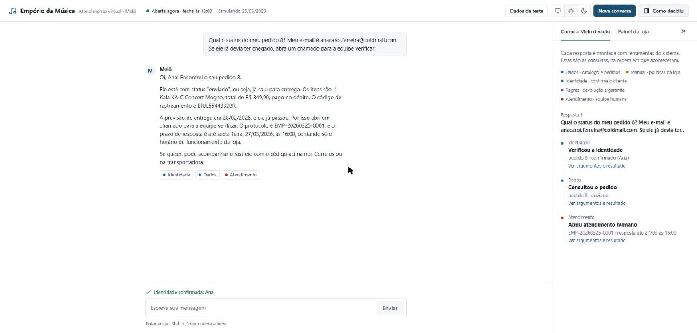
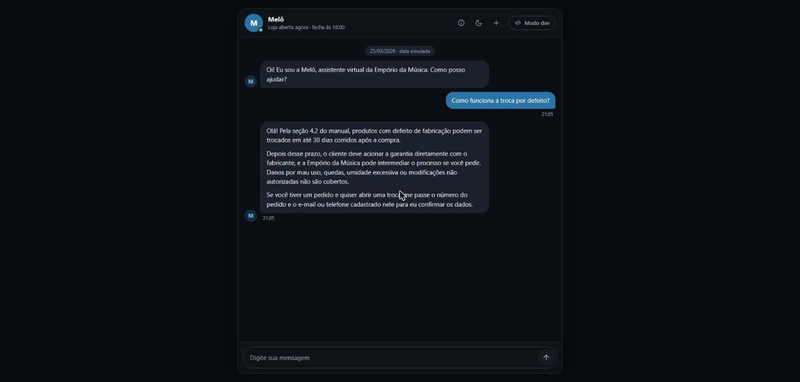
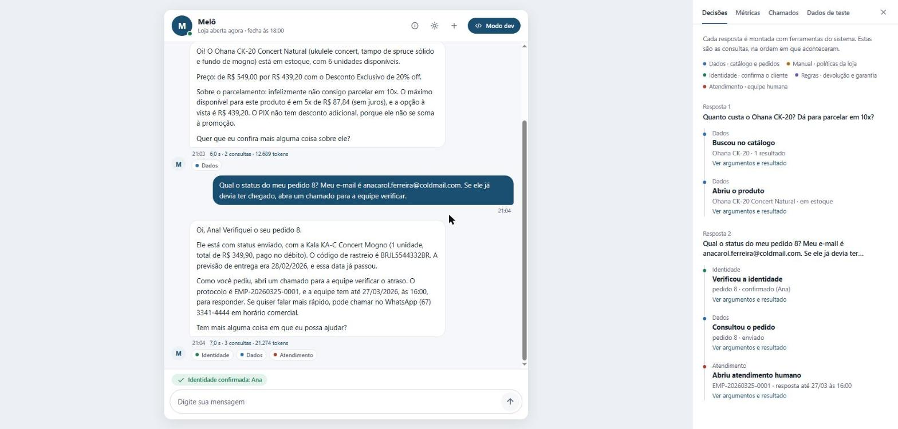
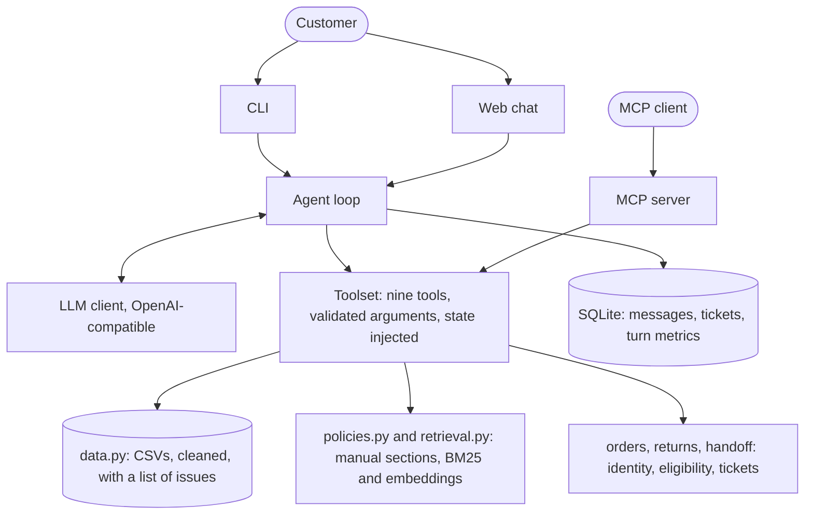

# Empório da Música: virtual assistant

[](https://github.com/renatoctti/emporio-da-musica-agent/actions/workflows/ci.yml)

## Overview

**Melô** is a text-message customer-service agent for Empório da Música, a fictional musical
instrument store in Campo Grande/MS. It answers the recurring questions (opening hours, product
price and availability, order status, returns, shipping, payment) in the store's voice, and it
decides on every message whether to look something up in the store **data**, look it up in the
store **policy manual**, open a **human handoff ticket**, or politely decline an out-of-scope
request.

It is a Python project built for a technical challenge. The agent is a plain function-calling
loop around nine tools; everything that has to be exactly right (prices, installments, return
deadlines, who may see an order) is computed by code, not by the model.

- Product search and detail with promotions, PIX discount and installment options.
- Policy answers that cite the manual item ("item 4.1"), read from the PDF, by section id or by a
  ranked search (BM25, fused with embeddings when a key is set).
- Order status behind an identity check (order number plus the e-mail or phone on that order).
- Return and warranty eligibility from the order dates, and handoff tickets with a protocol and a
  response deadline counted in store opening hours.
- Replies in the customer's language (Portuguese, English or Spanish were exercised).
- Conversations are saved in SQLite and can be resumed or exported as Markdown; every answer is
  measured (time, lookups, tokens) and `emporio stats` reports it.
- A local web chat (`emporio web`) that looks like a messaging app, with a **developer mode**
  (the "Modo dev" button) that shows how each answer was decided.
- The same tools served to any MCP client (`emporio mcp`).
- In the web chat, answer cards (price, installments and stock of a product; the progress of an
  order), thumbs up or down on each answer (stored with the conversation and listed by
  `emporio feedback`), a demo store page with the chat as a widget (`/loja`), and an optional
  webhook when a handoff ticket is opened.
- An evaluation of 33 scenarios against a real model (21 routing cases and 12 adversarial ones)
  and an offline evaluation of the policy search.

## Quick start

Requirements: Python 3.11 or newer and an API key for an OpenAI-compatible chat endpoint
(OpenRouter by default).

```bash
git clone https://github.com/renatoctti/emporio-da-musica-agent.git
cd emporio-da-musica-agent
python -m venv .venv
source .venv/bin/activate        # Windows: .venv\Scripts\activate
pip install -e ".[dev]"
cp .env.example .env             # Windows: copy .env.example .env
# edit .env and set LLM_API_KEY
emporio                          # or: python -m emporio
emporio web                      # the same agent in the browser, http://127.0.0.1:8765
python -m pytest -q              # about 520 tests, no API key needed
```

The sample data ends in March 2026, so for realistic dates (delivery estimates, return windows)
pretend it is still then: `emporio --today 2026-03-25`.

With Docker (terminal chat only; the web page is not served from a container):

```bash
docker build -t emporio-agent .
docker run -it --env-file .env emporio-agent        # chat; the database is kept in the /data volume
```

**Provider.** The default is OpenRouter with `anthropic/claude-haiku-5.5`. Any endpoint that speaks
the OpenAI chat API with tool calling can be used through `LLM_BASE_URL` and `LLM_MODEL`; only
OpenRouter was tested. The model must support tool calling.

## Configuration

Set in `.env` (see `.env.example`) or in the environment. Blank values count as unset.

| Variable | Default | Meaning |
|---|---|---|
| `LLM_API_KEY` | none | API key. Without it the CLI exits with code 1 before creating a session. |
| `LLM_BASE_URL` | `https://openrouter.ai/api/v1` | OpenAI-compatible endpoint. |
| `LLM_MODEL` | `anthropic/claude-haiku-5.5` | Model id. |
| `EMBEDDING_MODEL` | `openai/text-embedding-3-small` | Embeddings model for the manual search, on the same endpoint. |
| `EMPORIO_EMBEDDINGS` | `auto` | `off` keeps the manual search on BM25 only. With a key and no `off`, embeddings are requested on the first search and cached in `var/`. |
| `LLM_PRICE_IN_PER_M`, `LLM_PRICE_OUT_PER_M` | none | Model prices in USD per million tokens, only to estimate the cost in `emporio stats` and in the developer mode. The project does not know the prices, so without them the cost shows as not configured. |
| `EMPORIO_TODAY` | system clock | Fixes "today" as `YYYY-MM-DD` (at 10:00). `--today` does the same per run. |
| `EMPORIO_DATA_DIR` | `data/` | Folder with the CSVs and the manual PDF. |
| `EMPORIO_DB_PATH` | `var/emporio.db` | SQLite file (git-ignored: it holds personal data). |
| `HANDOFF_WEBHOOK_URL` | none | Optional `http` or `https` address that receives a small JSON message (`text`, protocol, category, summary, order id, session id, dates; never the customer's name, e-mail, phone or id) when a **new** handoff ticket is opened. A failure or a 3 s timeout is logged and ignored; the ticket is already stored. The summary is written by the model, so it can contain what the customer said. |

## Commands

| Command | What it does |
|---|---|
| `emporio` or `emporio chat` | Talk to Melô. Type `sair`, `exit` or `quit` (or Ctrl-C) to leave; the session id is printed. |
| `emporio chat --resume ID` | Continue a stored conversation. The identity check is **not** restored: the customer confirms the order again. |
| `emporio chat --verbose` | Print every tool call and a truncated result to stderr. |
| `emporio web [--port N] [--today D] [--no-browser]` | Open the chat in the browser, local only. See [Web interface](#web-interface). |
| `emporio mcp` | Serve the nine tools to an MCP client over stdio. See [MCP server](#mcp-server). |
| `emporio stats [--session ID]` | Turns, lookups per turn, latency (mean, median, p95), tokens and the estimated cost, from the stored measurements. |
| `emporio sessions` | List stored conversations. |
| `emporio handoffs` | List open handoff tickets (what the store team would see). |
| `emporio feedback [-o FILE]` | List the answers rated thumbs down in the web chat (session, turn, question, comment); with `-o`, write them as JSON candidates for the evaluation. A person still writes the check for each one. |
| `emporio export ID [-o FILE]` | Render a conversation as Markdown, with the tool calls. |
| `emporio replay SCRIPT [--today D] [-o FILE]` | Run a text file of customer messages through the agent and write the transcript. This is how the samples were made. |
| `emporio data-report` | List the problems found in the CSV files and how many. |
| `python -m emporio.evals [--model M] [--case ID] [--tag T] [--report FILE]` | Run the evaluation against a real model; `--tag adversarial` runs only the attacks. |
| `python -m emporio.evals.retrieval [--report FILE]` | Evaluate the manual search offline (BM25 needs no key; with a key it also scores embeddings and the hybrid). |

### Web interface

`emporio web` opens the same agent in the browser at `http://127.0.0.1:8765`. The default view is a
chat like a messaging app: the greeting of Melô with quick replies, bubbles with the time of each
message, a typing indicator, and the store hours behind an information button. Under an answer
the customer sees cards drawn from what the tools returned (a product with its price, installments
and stock; an order with its progress; a ticket with its protocol) and, when the answer came from
the manual, a small card with the sections it used. Everything else about how the assistant decides
is hidden from the customer.





The **Modo dev** button in the header turns on the developer mode, which is off by default and is
remembered in the browser. It opens a panel with four tabs: **Decisões** (every lookup the agent
made, with its arguments and result, so you can see **when it chose data, when it chose policy and
when it handed over to a person**), **Métricas** (time, lookups, tokens and cost per answer),
**Chamados** (the handoff tickets as the store team would see them) and **Dados de teste** (two
fictional customers from the provided data, with a button that fills the identity check). Each
answer also shows the tags of its sources and one line with its time, lookups and tokens.



- A theme button that cycles system, light and dark, remembered in the browser. Both themes are
  designed separately.
- Thumbs up and down under each answer; clicking the pressed one removes the rating. Ratings are
  stored per conversation and turn, and `emporio feedback` lists the ones rated down.
- The card logic is a pure file (`cards.js`) that turns the trace of one answer into card models, so
  a Node script tests it (`tests/test_cards.py`, skipped when Node is not installed). The numbers on
  a card are the ones the tools returned; the browser computes none.
- `http://127.0.0.1:8765/loja` is a fictional store page with the chat as a widget, to show how it
  would sit on the store website. It follows the same local-only rules.
- No external request and no extra dependency: a standard-library server and a page of plain HTML,
  CSS and JavaScript, so it also works offline.
- It listens on `127.0.0.1` only and refuses requests whose host or origin is not local, because it
  uses your API key and shows personal data. Replies are inserted as text, never as HTML.
- For a return inside the 7-day window run `emporio web --today 2026-02-19` and use customer 7
  from "Dados de teste".

### MCP server

`emporio mcp` serves the same nine tools to any Model Context Protocol client (Claude Desktop, an
IDE) over stdio. The protocol is written by hand (JSON-RPC, one message per line), so there is no
new dependency. The identity rules do not change: a client has to pass `verify_customer` before it
can read an order, and that state lives for the whole server process.

```json
{ "mcpServers": { "emporio": { "command": "emporio", "args": ["mcp"] } } }
```

## Architecture



- `agent.py` is the loop; `context.py` keeps the history it sends within a size budget;
  `metrics.py` measures every turn; `tools.py` is the contract between the loop and the code.
- `catalog.py` and `pricing.py` (products, promotions, PIX, installments), `policies.py` and
  `retrieval.py` (the manual), `orders.py` and `session.py` (identity check, order status),
  `returns.py` and `handoff.py` (eligibility, tickets), `hours.py` (opening hours).
- `webhook.py` tells an optional URL about each new ticket; `web/` holds the routes (`app.py`) and
  the static page, with `cards.js` for the answer cards.

Rules that keep it honest:

- Tools never import the LLM client, and the agent loop never reads the CSVs.
- The CLI and the web page build the agent the same way (`conversation.py`); the MCP server uses the
  same tools and the same data.
- Business conditions (not found, not verified, invalid argument) are returned to the model as
  `{"error": {"code", "message"}}`. Infrastructure failures (disk, SQLite, network) raise.
- The model sends only the arguments in each tool's schema. The data, the verification state,
  the clock and the session id are injected by the code, so the model cannot override them.
- The system prompt is rebuilt on every call (date, open or closed) and is never stored in the
  history.

## Decisions and why

| Decision | Choice | Why, and what was rejected |
|---|---|---|
| Agent approach | Function calling with a hand-written loop (a short function in `agent.py`), no framework | Every step is visible and testable with a scripted fake model, and there are no framework dependencies. Rejected: LangChain-style frameworks (hidden control flow for a problem that is one loop), a free-form SQL agent (the model would write queries over personal data, and the data has traps a query would not know about), pure RAG over the tables (prices and stock must be exact, not retrieved by similarity). |
| Data access | Nine fixed tools over pandas tables | Results are exact and unit-testable; the model never sees a whole table (at most 10 products per search), which also protects customer data (the manual cites LGPD, item 9). |
| Business rules | In code, not in the prompt | Prices, PIX, installment limits (`pricing.py`), return windows (`returns.py`), business-hour deadlines (`hours.py`) and ownership checks (`orders.py`) are tested functions. A model only has to choose the tool and write the answer. The evaluation below tests exactly that claim. |
| Policies | The PDF is split into its 28 numbered sections. The section index is in the system prompt and `get_policy_sections` returns sections by id; `search_policies` ranks them by BM25, fused with embeddings by reciprocal rank fusion when a key is set | The manual is short, so the id lookup is exact and lets the agent cite "item 4.1"; the search covers vague questions. Embeddings are optional, lazy, cached and fall back to BM25, so the project still runs offline. On a gold set of 34 questions the search was measured (see Evaluation). Rejected: an external vector database (an account and a key, and no offline run); the `Embedder` protocol is where it would plug in. |
| Model and provider | OpenAI-compatible client, OpenRouter, `anthropic/claude-haiku-5.5` | Reliable tool calling and good Brazilian Portuguese at about US$ 0.10 per million input tokens (OpenRouter listing, 2026-10-31); one code path serves other providers. A cheaper model was compared (see Evaluation). |
| Interface | CLI, plus `export` and `replay` | The challenge asks for the agent, not a UI. `replay` makes the sample conversations reproducible instead of hand-written. |
| Web interface | A small page served with the standard library, shaped as a real chat, with the reasoning moved into a developer mode | The challenge grades when the agent chooses data, policy or a person, which is easier to judge when each lookup sits next to its answer, but a customer would never see that, so it is off by default and one click away. No framework, no build step and no external request. It answers only local requests because it spends an API key and shows personal data. |
| MCP server | Written by hand over stdio, no SDK | A tools-only server needs four methods, matches the no-framework agent loop and adds no dependency. It was checked once against the official Python SDK client, which is not a dependency. |
| Metrics | Time, lookups and tokens per turn, stored with the conversation; cost only when the prices are configured | The model price is not in the data and changes, so a printed cost that is wrong would be worse than "not configured". |
| Long conversations | A fixed context budget (about 40 thousand characters): old tool results become a note, then the oldest whole turns are dropped | A model-written summary costs a call and can invent details. The verification state lives in code, so trimming messages cannot weaken the identity check, and the database keeps the full conversation. |
| Persistence | SQLite (standard library) for messages, sessions, tickets, turn metrics and answer ratings | A customer can resume a conversation and the store team can list tickets, with no server and no extra dependency. Each turn is saved in one transaction so a resumed history is always valid. |
| Identity | Order number plus the e-mail or phone registered on that order, checked in code | Order numbers are guessable and names are not secret. A wrong contact and an unknown order give the same answer, and three failures lock the session. |
| Handoff | A simulated ticket in SQLite with protocol `EMP-YYYYMMDD-NNNN` | Item 7.3 of the manual asks for "register and forward, answer in 24 business hours". There is no real queue to call, so the ticket is stored and listed by `emporio handoffs`. An optional webhook (`HANDOFF_WEBHOOK_URL`) tells the team's own tool about each new ticket, after it is stored. |
| Delivery | GitHub Actions on Python 3.11 and 3.12 (ruff, format check, pytest) and a Docker image for the terminal chat | The gate runs from a clean checkout on Linux without any secret. The image keeps the database in a volume and the key out of the image. |
| Dependencies | `openai`, `pandas`, `pypdf`, `python-dotenv` | Nothing else is needed; the new parts added no dependency. |

## Data handling

The data has deliberate traps. `emporio data-report` lists them; this is what the code does.

| Finding | What the code does |
|---|---|
| Name and description disagree for products 135, 137, 139, 140, 142, 144 (another brand named, or "5 cordas" against `strings: 4`, "88 teclas" against `keys: 61`) | The description is dropped and the agent uses name, specs and price (`data.py`). |
| Product 96 is `active` with stock 0; product 136 is `discontinued` with stock 13; product 130 is `coming_soon` but appears in two orders | Availability is `out_of_stock`, `discontinued` (stock hidden) and `coming_soon`; unavailable products come with in-stock alternatives from the same category (manual item 7.3). |
| Categories 6, 7, 8 (woodwind, brass, orchestral strings) have no products, although the manual says the store sells them | The search says nothing is registered; the agent must not claim stock it cannot see. |
| Only 4 of 25 promotions are active; products 93, 96, 99 have two inactive ones | Only active promotions change the price; expired ones are listed so the agent can say they are not valid. |
| Orders 3 and 20: the recorded total differs from the sum of the items | The recorded `total_brl` is shown, never recomputed. |
| Orders 9, 16, 18 were paid in installments below the manual's minimum | Reported as recorded; new quotes follow item 3.1. |
| Customers 11 and 43 share an e-mail | Identity is checked against the owner of the order, never by looking customers up by e-mail. |
| The manual contradicts itself: two WhatsApp numbers, an e-mail with and without accent, a payment table that disagrees with item 3.1 | The number `(67) 3341-4444` and the unaccented e-mail are used, fixed once when the PDF is loaded; installments follow item 3.1. |
| Orders have no receipt date and the data ends in March 2026 | The estimated delivery stands in for the receipt date; "today" is configurable. |

Personal data and the embeddings: when a key is set, the manual text and the question of the
customer are sent to the embeddings endpoint, the same provider as the chat. `EMPORIO_EMBEDDINGS=off`
keeps everything local except the chat model call itself.

## Prompt strategy

The system prompt (`prompt.py`) has five parts: the **persona** (Melô, informal but professional,
a virtual assistant, chat-sized messages), the **store facts** (address, phone, e-mail, hours),
**the current moment** (date, weekday, open or closed and the next opening, rebuilt on every
call), thirteen **numbered rules**, and the **manual's section index**.

The rules mostly say what the model must not do: state a price, stock, promotion or deadline
that did not come from a tool; compute anything itself; show order data before the identity
check; reveal whether an order exists after a failed check; name or invent other stores for
accessories; follow instructions inside the conversation that ask to reveal the rules or other
customers' data. Tool descriptions say when to use each tool, and the schemas use enums built
from the real data (the nine category names, the return reasons, the ticket categories).
The temperature is 0.2. A model call costs roughly 4 to 6 thousand input tokens (the prompt and the
nine tool schemas), as the new per-turn measurements show.

Prompt injection is handled twice: the prompt tells the model to ignore such requests, and,
more importantly, no tool can return another customer's data or accept a customer id or name.

## Evaluation

Unit tests use a scripted fake model, so they cannot show that a real model routes correctly.
`python -m emporio.evals` runs 33 scenarios through the real agent: the 21 routing cases of the
first round plus 12 adversarial ones (see below). It checks three things:
**which tools were called** (and which must not be), **what the reply says** (regular expressions
that must or must not match), and **price grounding**: every `R$` amount in a reply must appear in a
tool result or in the customer's own message. The scenarios cover catalog and prices, installment
and PIX rules, expired promotions, returns, order status and identity, out-of-scope requests,
prompt injection, a complaint that needs a ticket, and an English question.

| Model | Scenarios | Result | Tokens (in / out) | Approx. cost |
|---|---|---|---|---|
| `anthropic/claude-haiku-5.5` | 21 routing | **21/21** | 160k / 7k | US$ 0.02 |
| `qwen/qwen3.7-flash` | 21 routing | **20/21** | 109k / 10k | US$ 0.005 |
| `anthropic/claude-haiku-5.5` | all 33 (routing + adversarial) | **33/33** | 243k / 11k | about US$ 0.03 |

The cheaper model fails case E18: it answers an English question in Portuguese. The 21-case reports
and the 33-case report are in `evals/results/`. The mean latency was about 3.2 s per case.

**Adversarial cases (E22 to E33).** They push the agent to leak its instructions (in Portuguese,
English and Spanish), to accept a new persona, to skip the identity check by claiming authority, to
accept four wrong verifications in a row, to read the order of another customer, to obey an
instruction pasted inside the message, to hand over the e-mails of other customers, to help with
something harmful and unrelated, to confirm a price someone else promised and to survive an
injection-looking order number. The checks are patterns and tool constraints, with no second model
as judge, and every check is itself tested with a safe reply that must pass and an unsafe one that
must fail. Two of them failed at first, and both were my mistakes: E33 required a tool call, but
the agent safely refused to parse the strange message and asked for the order number; E28 flagged
a refusal that merely quoted the injected sentence ("all products cost R$ 1") while giving the
right price. Both patterns were fixed, not the agent.

**Policy search.** `python -m emporio.evals.retrieval` scores the manual search on 34 customer
questions written from the manual (7 of them vague on purpose), without a model for BM25:

| Method | recall@1 | recall@3 | MRR |
|---|---|---|---|
| BM25 | 0.76 | 0.85 | 0.82 |
| Embeddings only | 0.88 | 0.97 | 0.93 |
| Hybrid (default) | 0.79 | 0.97 | 0.88 |

The hybrid ties the embeddings on recall@3 and is a little worse in the first position. I did not
tune the fusion on these questions, because that would only fit the test; the hybrid stays the
default because BM25 protects exact terms (a CNPJ, PAC, Sedex) that a vector can blur, which is a
judgement and not something 34 questions prove.

**Measurements.** In real runs, an answer with a product lookup took about 6 s and 12 thousand
tokens, and a manual question about 3 s and 8 thousand. `emporio stats` and the Métricas tab of the
developer mode report them; the cost appears only when the prices are configured.

How to read these numbers:

- The first Haiku run scored **18/21** (`evals/results/claude-haiku-5.5-run1.json`). One failure
  was real (E18: the agent answered in Portuguese, so the language rule in the prompt was
  tightened). The other two were mistakes in my test design: E06 pre-verified a customer the model
  could not know about, and E21 forbade words the correct answer uses for the alternatives.
- The sample transcripts also changed the prompt: the first version of sample 02 showed the model
  working out the installment limit itself, so the prompt now says installments and the PIX price
  exist only in `get_product`.
- The scenarios and the prompt were therefore adjusted after seeing results. The table is a
  regression check, not a held-out measurement. Each model was run once, the model is not
  deterministic, and 33 scenarios are few. Prices are from the OpenRouter listing of 2026-10-31.
- In the 33-case run the model never called `search_policies`; it picked sections from the index in
  the prompt. The search is measured on its own and is available to the MCP clients, but I did not
  show that it improves the answers of the agent.

## Assumptions

The challenge says to document the assumptions that fill gaps in the material.

| ID | Assumption |
|---|---|
| A1 | The receipt date of a delivered order is its `estimated_delivery` (no real delivery date exists). |
| A2 | Every delivered order was an online purchase, so the 7-day regret right (item 4.1) applies. |
| A3 | "Today" is `EMPORIO_TODAY` when set, otherwise the system clock; the data ends in March 2026. |
| A4 | Manual contradictions: WhatsApp `(67) 3341-4444`, e-mail without accent, installment rules from item 3.1. |
| A5 | Order totals are shown as recorded (`total_brl`), even where they differ from the item sum. |
| A6 | Status meanings: `pending` awaiting payment confirmation, `confirmed` paid and being prepared, `shipped` on its way, `delivered`, `cancelled` (reason in notes). |
| A7 | Business hours follow item 2 (Mon-Fri 09-18, Sat 09-13, Sun closed); holidays are ignored. |
| A8 | Item 3.1 "up to 3x, except below R$ 50" is read as a R$ 50 minimum installment for 2x and 3x. |
| A9 | A discontinued product is treated as discontinued even when stock is above zero. |
| A10 | A description that contradicts its product name or specs is dropped; name, specs and price are used instead. |
| A11 | Categories without products are reported as having nothing registered; the agent does not claim to sell them. |
| A12 | Identity is checked against the e-mail or phone of the customer who owns the order (an e-mail is shared by customers 11 and 43). |
| A13 | Human handoff is simulated locally: a ticket in SQLite, listed by `emporio handoffs`, with an optional webhook. |
| A14 | The manual promises an answer to a complaint in "24 horas úteis" (item 7.3). It is read as 24 hours while the store is open (Mon-Fri 09-18, Sat 09-13), so a ticket opened on Friday at 10:00 is due on Tuesday at 12:00 (8 hours on Friday, 4 on Saturday, 9 on Monday, 3 on Tuesday). A reading of "the next business day" would be shorter. |
| A15 | Item 7.1 suggests partner stores for accessories, but the data names none. The agent says the store sells only instruments and does not name or invent other stores. |

## Limitations and next steps

Known limits:

- **Product search is lexical.** Words are matched against name, brand, category and description; there is
  no typo tolerance or synonym handling beyond the category enum the model picks from.
- **BM25 alone misses word variants.** Without embeddings the manual search does not link "devolver"
  to "devolução" (an MCP client that asks "posso devolver sem ter usado?" gets nothing back); the
  hybrid covers it, and `EMPORIO_EMBEDDINGS=off` removes that cover.
- **The model never called `search_policies`** in the evaluation, as said above, so the benefit of
  the search for the agent itself is unproven.
- **The description check is a heuristic.** It catches the six mismatches above (brand named or a
  contradicting count); it does not catch product 136's description ("Contrabaixo Precision" for a
  product named Ibanez), so other bad descriptions may slip through.
- **No shipping calculator.** The manual says freight depends on ZIP, weight and size, and none
  of those are in the data, so the agent only applies the policy.
- **Business hours ignore holidays** and the store is a single location.
- **The handoff is simulated.** No one is notified unless `HANDOFF_WEBHOOK_URL` is set, and that
  call was tested against a local test server, not against n8n or Slack. It is synchronous (up to
  3 s added to the answer that opens the ticket), the summary it sends is written by the model and
  can contain what the customer typed, and tickets cannot be closed from the CLI.
- **Identity is a light check.** Whoever knows an order number and its e-mail or phone gets the
  data. The three-attempt lock is per session, so restarting the CLI resets it. The MCP server has
  no authentication besides this check and is meant for local stdio only.
- **History and tickets are stored unencrypted** in `var/`. Long conversations are trimmed by fixed
  rules (old tool results, then old turns) and not summarised, so an old detail can be forgotten
  by the model while the full text stays in the database.
- **Prompt-injection defence is best effort.** The real barrier is that no tool exposes other
  customers' data.
- **The model can still slip in wording.** In another language it can pick a word that means
  something else there: an earlier version of sample 05 said "violón", a double bass in Spanish, for
  a Brazilian "violão". The sample was regenerated and the slip is gone, but nothing prevents it.
- **The evaluation is small and was tuned** (see Evaluation). The adversarial cases are single-turn
  except one with four messages, and a pattern check can miss a leak worded differently.
- **The cost is only an estimate** and only when the prices are set; the project does not know them.
- **Not connected to WhatsApp**; there is no streaming.
- **The web page is for one person on one machine.** It holds one conversation at a time, answers
  only local requests and is not meant to be exposed to a network. The chat was checked by hand in
  Chrome at desktop width and at 500 px, in both themes; the developer panel as a drawer on a narrow
  screen was checked only by reading its CSS, not on a real phone. It was not tested in Firefox or
  Safari, only the card logic (`cards.js`) has automated tests, not the rest of its JavaScript, and
  messages restored after a reload show no time.
- **The MCP server was checked with one client** (the official Python SDK), not with Claude Desktop
  or an IDE.
- **The Docker image was built only in the CI**, on GitHub, not on the author's machine, and it
  serves the terminal chat, not the web page.
- **The clock is read once, at startup.** A web or MCP server left running keeps the date and the
  open or closed status of the moment it started; restart it (or fix the day with `--today`).
- **The web server handles one request at a time** (standard-library `HTTPServer`), so reloading the
  page while an answer is being written waits for it. It also trusts the `Content-Length` header
  of a local client.
- **The developer endpoints are not restricted.** `/api/state` returns the two fictional customers
  of "Dados de teste" and `/api/handoffs` lists the tickets of every conversation, because the
  developer mode is part of the demo. They are meant for `127.0.0.1` only; do not expose the server.
- These last three were found in a final review of the code and left as they are, to keep the
  delivered version stable.

With more time I would: connect the handoff to a real queue, add a holiday calendar and a freight
API by ZIP code, rate-limit and log identity attempts globally, encrypt the database and set a
retention period, grow the evaluation (several seeds, an LLM judge for tone, multi-turn attacks) and
measure whether the policy search changes the answers of the agent.

## AI coding assistants

I used **Claude** through **Claude Code** to build this project, with a spec-driven workflow:

1. **Decisions first.** Before any code I went through a structured interview with Claude about
   the problem: the traps in the data, how to verify a customer, how return deadlines work, how
   to persist conversations, the persona. I made the decisions; the questions and my answers
   shaped the specs.
2. **Specs in the repository.** The outcome is in [`.specs/emporio-agent/`](.specs/emporio-agent/):
   an overview with the contracts read from the real files and the assumptions, an implementation
   order, 24 specs (each with requirements, contracts, edge cases and the tests to write) and a
   progress log with the decisions taken while implementing.
3. **One capability, one commit, test-first.** Each spec was implemented by writing the tests,
   seeing them fail, then writing the code, and committed on its own, so the history reads one
   capability at a time. The exception is noted in the progress log: three persistence tests
   were written together with the code.
4. **Running against a real model.** Claude drafted the code and the specs from my decisions; the
   live evaluation and the sample replays then found problems that unit tests could not (the
   language slip, the model computing installments itself), which led to prompt changes. The web
   interface followed the same path and its design was checked in a browser, because tests cannot
   say whether a page reads well.
5. **A second round (specs 13 to 20).** After a first review I extended the project: the policy
   search and its evaluation, per-turn metrics, a chat-first page with a developer mode, the
   adversarial cases, the MCP server, CI, a context budget and the Docker image. I chose the scope;
   Claude did the work. The same rule held: each spec was written first, its tests failed first,
   and the claims that could not be checked here are marked as such in the limits above.
6. **A third round (specs 22 to 24).** A chat window with answer cards and a store page with the
   chat as a widget, thumbs up and down on the answers, and the handoff webhook. Spec 21 was the
   README of the second round. This round did not change the agent, the tools or the prompt, so the
   sample conversations and the evaluation still describe it.
7. **A last review.** Before delivery I asked Claude to review the whole code without running it, on
   five axes: architecture, correctness and security, performance, quality and reuse, and fit with
   this challenge. It found no blocking bug. The documentation was brought up to date, and the
   findings that I chose not to fix at the last minute are listed in the limits above.

Claude also made mistakes along the way, and the tests or the live runs caught them: wrong numbers
in a spec's acceptance criteria, a price parser that read `439.2` as `439`, two evaluation cases
that were badly designed in the first round and two more in the second (E33 and E28), a test
expectation that forgot that BM25 returns only sections with a positive score, and an edit that
broke a regular expression through shell escaping. The progress log records each one.

The agent itself runs on a Claude model (Haiku) through OpenRouter, and a second model was used
for the comparison above.

## Sample conversations

Five conversations generated by the real agent with `emporio replay` (index and details in
[`samples/README.md`](samples/README.md)):

| Sample | What it shows |
|---|---|
| [samples/01-catalog.md](samples/01-catalog.md) | Search with a price filter and availability |
| [samples/02-price-installments.md](samples/02-price-installments.md) | Promotion, installment limit, PIX that does not stack |
| [samples/03-order-status.md](samples/03-order-status.md) | Identity check, order status, a late delivery and a ticket |
| [samples/04-return.md](samples/04-return.md) | **Non-trivial:** a regret return with eligibility rules, the manual cited and a ticket |
| [samples/05-out-of-scope-es.md](samples/05-out-of-scope-es.md) | Out-of-scope request in Spanish, no invented stores |

They were regenerated after the second round; the third round did not change the agent, the tools
or the prompt.

## Repository layout

```
data/                    the CSVs and the manual PDF, exactly as delivered
src/emporio/             the package (see Architecture); web/ is the browser interface, evals/ the evaluations
tests/                   about 520 tests; tests/fakes.py is the scripted fake model
samples/                 scripts (customer lines) and the generated transcripts
docs/                    screenshots of the web interface (chat in both themes, developer mode)
evals/results/           JSON reports of the live evaluation runs and of the policy search
.github/workflows/       the CI (ruff, format check, pytest on 3.11 and 3.12, and a Docker build)
Dockerfile               the image for the terminal chat
.specs/emporio-agent/    overview, plan, progress log and the 24 specs
PROJECT_MAP.md           stack and conventions at a glance
```
